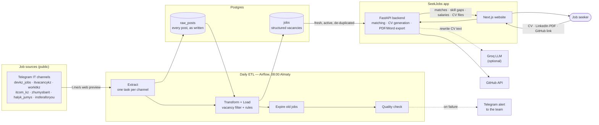
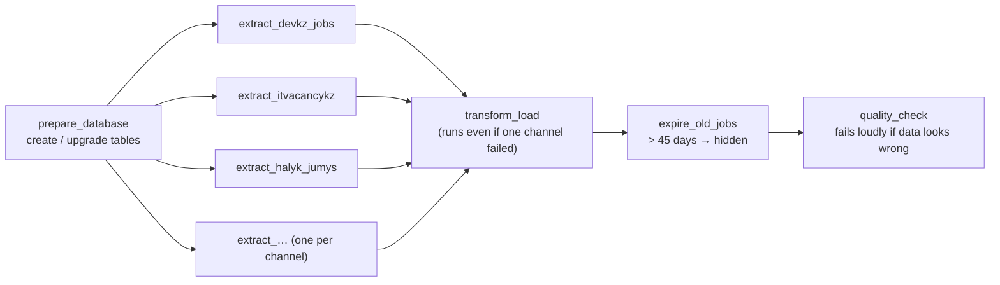
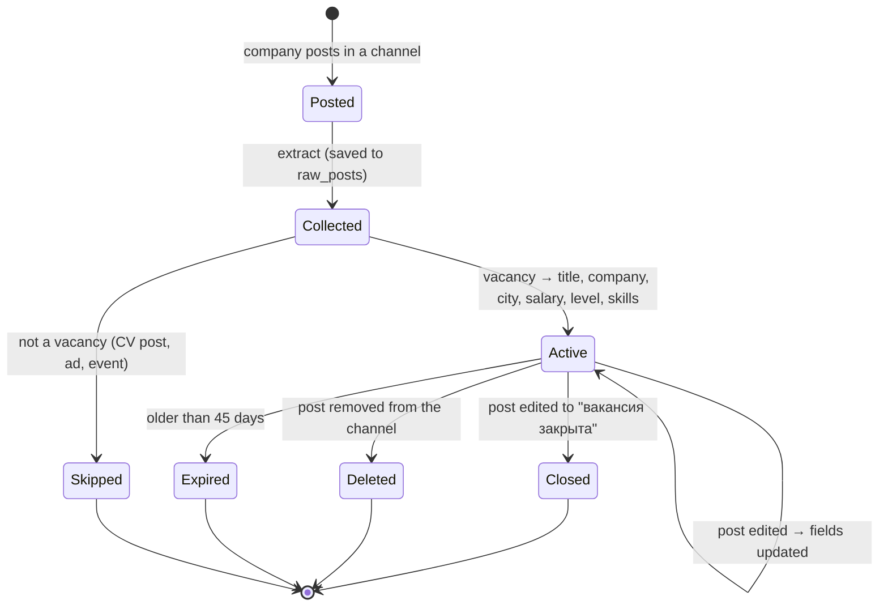
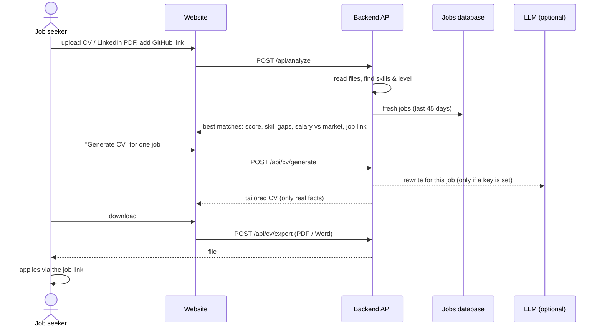
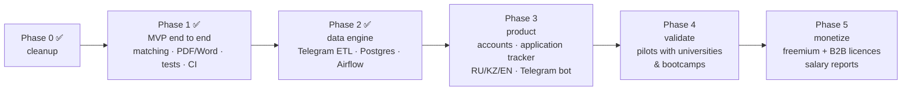

# SeekJobs — how it works

GitHub draws the diagrams below automatically (Mermaid).

## 1. The whole system

## 2. The daily ETL (Airflow DAG `seekjobs_daily_vacancies`)

- 3 channels are fetched at a time (polite to Telegram); a failed channel is retried twice, 10 minutes apart.
- Each run re-reads the last 7 days of every channel, so **edited** posts are updated and **deleted** posts disappear.
- The same steps run without Airflow: `cd pipeline && python run_daily.py`.

## 3. Life of one vacancy

Only **Active** jobs are shown on the site; the same job reposted in several channels is shown once.

## 4. What a job seeker does

## 5. Project roadmap

